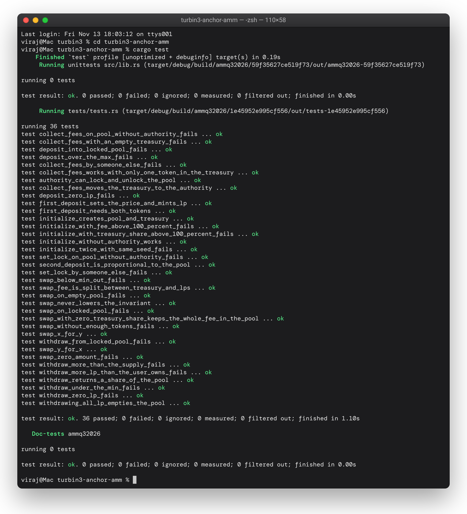

# turbin3-anchor-amm

A constant-product AMM on Solana, written in Anchor for Week 3 of the Turbin3 Builders Cohort.

Two tokens, X and Y, sit in a pool. Anyone can add liquidity and get LP tokens back, burn LP tokens to take their share out, or swap one token for the other at the price set by `x * y = k`. Every swap pays a fee: most of it stays in the pool for the liquidity providers and a share of it goes to a **treasury** that the pool authority can collect.

Program id: `wwPRtu5gM4m9GWbEkyvvP2E2Zhwfhe2wC7gVm7zTCrT`

Starting point: the class starter [ShrinathNR/turbine-amm](https://github.com/ShrinathNR/turbine-amm) (`initialize` and `deposit`). I kept its structure and naming and added `withdraw`, `swap`, `set_lock`, the fee split, the treasury and `collect_fees`. The curve maths comes from the [constant-product-curve](https://github.com/deanmlittle/constant-product-curve) crate, as taught in class. I skipped the optional extensions.

## Accounts

```
                       ┌──────────── config PDA ["config", seed] ────────────┐
                       │ seed, authority, mint_x, mint_y, fee,               │
                       │ treasury_share, locked, bumps                       │
                       └───────┬───────────────────────────────┬─────────────┘
                  authority of │                               │ mints LP
            ┌──────────────────┴───────┐                       ▼
            ▼                          ▼             mint_lp PDA ["lp", config]
     vault_x = ATA(config, X)   vault_y = ATA(config, Y)

     treasury PDA ["treasury", config]
            ├─ treasury_x = ATA(treasury, X)    protocol share of the swap fees
            └─ treasury_y = ATA(treasury, Y)
```

| Account | Type | Seeds / derivation | Purpose |
|---|---|---|---|
| `config` | `Account<Config>` | `["config", seed.to_le_bytes()]` | Pool settings; also the authority of the vaults and the LP mint |
| `mint_lp` | `Account<Mint>` | `["lp", config]` | LP token, 6 decimals, only the config PDA can mint it |
| `vault_x` / `vault_y` | `Account<TokenAccount>` | ATA of (`config`, mint) | The pool's reserves |
| `treasury` | `SystemAccount` | `["treasury", config]` | Owns the two treasury token accounts, holds no data |
| `treasury_x` / `treasury_y` | `Account<TokenAccount>` | ATA of (`treasury`, mint) | Collected protocol fees, one per token |
| `user_x` / `user_y` / `user_lp` | `Account<TokenAccount>` | ATA of (user, mint) | The user's token accounts |

The `seed` lets the same pair of tokens have several pools, for example with different fees.

### Config

| Field | Meaning |
|---|---|
| `seed` | Makes the config PDA unique |
| `authority` | `Option<Pubkey>`: can lock the pool and collect treasury fees. `None` means nobody can |
| `mint_x`, `mint_y` | The pair |
| `fee` | Swap fee in basis points, taken from the amount swapped in (`30` = 0.30%) |
| `treasury_share` | Part of the fee that goes to the treasury, in basis points of the fee (`2000` = 20%) |
| `locked` | When true, deposit, withdraw and swap are blocked |

## Instructions

| Instruction | Signer | Args | What it does |
|---|---|---|---|
| `initialize` | initializer | `seed, fee, treasury_share, authority` | Creates the config, the LP mint, both vaults, the treasury PDA and its two token accounts |
| `deposit` | user | `amount, max_x, max_y` | Mints `amount` LP tokens. The first deposit sets the price and takes `max_x` / `max_y`; later ones take X and Y in the pool's ratio and fail if that is more than `max_x` / `max_y` |
| `withdraw` | user | `amount, min_x, min_y` | Burns `amount` LP tokens and sends back that share of both vaults, failing if it is less than `min_x` / `min_y`. Burning the whole supply takes whatever is left |
| `swap` | user | `is_x, amount_in, min_out` | Pays `amount_in` of one token, receives the other from the curve, fails if the output is below `min_out`. Creates the user's token accounts if they are missing |
| `set_lock` | authority | `locked` | Locks or unlocks the pool |
| `collect_fees` | authority | – | Moves everything in the treasury to the authority's token accounts |

## Fees and the treasury

The swap fee is taken from the input before the price is worked out:

```
fee           = amount_in * config.fee / 10_000
amount_in_net = amount_in - fee
amount_out    = y - k / (x + amount_in_net)            (for an X → Y swap)

to treasury   = fee * config.treasury_share / 10_000
to vault      = amount_in - to treasury
```

For example, with `fee = 30` and `treasury_share = 2000`, a swap of 10 X pays a fee of 0.03 X. 0.006 X goes to `treasury_x` and the other 0.024 X stays in `vault_x`, so the pool's `k` grows a little with every swap and LPs earn the difference. The treasury token accounts belong to a PDA, so only the program can move them, and only `collect_fees` does, after checking that the signer is the pool `authority`.

## Security checks

| Check | Where | Error |
|---|---|---|
| Fee and treasury share can't be above 100% (10,000 bps) | `initialize` | `InvalidFee` |
| X and Y must be different mints | `initialize` | `InvalidToken` |
| One pool per seed: `init` fails if the config exists | `initialize` | system "already in use" |
| Mints must match the config (`has_one`), config / LP mint / treasury PDAs are re-derived from stored bumps | all | Anchor constraint |
| Vaults and treasury accounts must be the right ATAs | all | Anchor constraint |
| Pool must not be locked | `deposit`, `withdraw`, `swap` | `PoolLocked` |
| Amounts must be > 0 (a swap that would pay out 0 is rejected too) | `deposit`, `withdraw`, `swap` | `InvalidAmount` |
| First deposit needs both tokens | `deposit` | `InvalidAmount` |
| Slippage: deposit above `max_x` / `max_y`, withdraw below `min_x` / `min_y`, swap below `min_out` | `deposit`, `withdraw`, `swap` | `SlippageExceeded` |
| Can't withdraw more LP than exists (or than the user holds, the burn fails) | `withdraw` | `InsufficientBalance` |
| Swapping in an empty pool | `swap` | `NoLiquidityInPool` |
| Only the stored authority can lock, unlock or collect | `set_lock`, `collect_fees` | `InvalidAuthority` |
| Pool created without an authority can never be locked or collected from | `set_lock`, `collect_fees` | `NoAuthoritySet` |
| Nothing in the treasury | `collect_fees` | `NothingToCollect` |

## Build and test

Requirements: Rust (stable), the Solana CLI (I used Agave 4.3.1) and optionally the Anchor CLI. Built with `anchor-lang` and `anchor-spl` 1.2.2 and tested with LiteSVM 0.16.

```bash
git clone https://github.com/viraj-mahida/turbin3-anchor-amm.git
cd turbin3-anchor-amm

# build the program to target/deploy/ammq32026.so
cargo build-sbf --arch v0

# run the LiteSVM tests (they load the .so from target/deploy)
cargo test
```

`anchor test --skip-build` runs the same two steps through the script in `Anchor.toml`.

> **Why `--arch v0`?** Agave 4.x defaults `cargo build-sbf` to SBPF v3. I build for v0, the most widely supported target, so the same `.so` loads in LiteSVM without any extra flags.

The tests are written in Rust with [LiteSVM](https://github.com/LiteSVM/litesvm) in [`programs/ammq32026/tests/tests.rs`](programs/ammq32026/tests/tests.rs). The instruction builders for each instruction live in `tests/ix_handlers/`, like in the starter. Every test creates two fresh mints, funds the wallets, and starts from a pool with the default settings: fee 30 bps, treasury share 20%, and 100 X / 200 Y of opening liquidity for 100 LP.

| Instruction | Tests |
|---|---|
| `initialize` | `initialize_creates_pool_and_treasury`, `initialize_with_fee_above_100_percent_fails`, `initialize_with_treasury_share_above_100_percent_fails`, `initialize_twice_with_same_seed_fails`, `initialize_without_authority_works` |
| `deposit` | `first_deposit_sets_the_price_and_mints_lp`, `second_deposit_is_proportional_to_the_pool`, `deposit_over_the_max_fails`, `deposit_zero_lp_fails`, `first_deposit_needs_both_tokens`, `deposit_into_locked_pool_fails` |
| `withdraw` | `withdraw_returns_a_share_of_the_pool`, `withdrawing_all_lp_empties_the_pool`, `withdraw_under_the_min_fails`, `withdraw_zero_lp_fails`, `withdraw_more_than_the_supply_fails`, `withdraw_more_lp_than_the_user_owns_fails`, `withdraw_from_locked_pool_fails` |
| `swap` | `swap_x_for_y`, `swap_y_for_x`, `swap_fee_is_split_between_treasury_and_lps`, `swap_never_lowers_the_invariant`, `swap_with_zero_treasury_share_keeps_the_whole_fee_in_the_pool`, `swap_below_min_out_fails`, `swap_zero_amount_fails`, `swap_without_enough_tokens_fails`, `swap_on_empty_pool_fails`, `swap_on_locked_pool_fails` |
| `set_lock` | `authority_can_lock_and_unlock_the_pool`, `set_lock_by_someone_else_fails`, `set_lock_on_pool_without_authority_fails` |
| `collect_fees` | `collect_fees_moves_the_treasury_to_the_authority`, `collect_fees_works_with_only_one_token_in_the_treasury`, `collect_fees_by_someone_else_fails`, `collect_fees_with_an_empty_treasury_fails`, `collect_fees_on_pool_without_authority_fails` |

36 tests in total. The swap tests work out the expected output with their own copy of the `x * y = k` formula and compare it to the real vault and wallet balances, so they check the program against the maths and not only that the transaction succeeds.



## What I learned

- **The config PDA is the pool.** It owns both vaults and is the mint authority of the LP token, so the program signs for it with `["config", seed, bump]`, and no wallet can touch the reserves.
- **`precision` is a multiplier, not a number of decimals.** The starter passes `6` to the curve's deposit maths. That happens to work when the amounts are powers of two, but my first withdraw test (burn 25 of 100 LP) paid out a third of the pool instead of a quarter. The crate divides by `precision` directly, so I now pass `1_000_000`.
- **The fee has to come out before the price is worked out.** Taking it off `amount_in` first means the trader gets a slightly worse price and the pool ends up with more tokens than the curve asked for, so `k` only ever goes up. One of the tests checks this.
- **The treasury needs its own owner.** If the treasury token accounts were owned by the config, there would be no clean way to tell protocol fees from LP funds. A separate PDA keeps them apart, and `collect_fees` is the only place that signs for it.
- **Slippage protection belongs in every instruction that prices something.** The price moves between the moment a user signs and the moment the transaction lands, so `deposit`, `withdraw` and `swap` all take a limit from the user and revert if the pool doesn't meet it.
- **Tests for the failure paths matter as much as the happy path.** Most of the checks in the table above are only proven by a test that tries to break them: wrong signer, locked pool, zero amount, empty pool.

## Known limitations

This is an assignment, not a production AMM:

- Pools only support classic SPL Token mints, not Token-2022.
- The first depositor chooses the opening price and the LP amount, and there is no minimum liquidity locked, so it is open to the usual first-deposit tricks.
- The deposit and withdraw maths rounds with a precision of 1e6, so very small amounts can be off by a few units.
- The fee is fixed when the pool is created. There is no instruction to change it.
